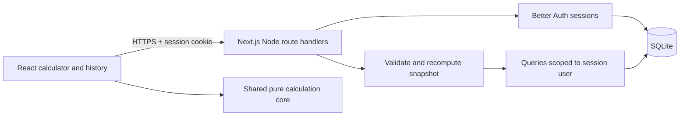

# HealthMetrics architecture

## Data flow

Anonymous calculation remains browser-local. Only the explicit save action sends a profile to the server. The server validates the profile independently, computes its own result and stores a snapshot with a formula version. Future profile edits cannot silently change old snapshots. A PATCH is an explicit revision that recomputes the snapshot.

History reads require a database-backed session. Every assessment operation includes the session user ID in the SQL predicate. Client-supplied owner IDs and computed results are never authoritative. Cross-user reads and writes return 404. Lists are paginated and filterable by measurement date.

Better Auth handles password hashing, sign-in, database sessions and cookie issuance. Application mutations enforce the configured origin. Credentials and private records are excluded from source control and container build contexts.

## Why this stack

Next.js route handlers keep frontend and backend in one TypeScript repository. The same calculation module is used for browser previews and server snapshots. SQLite is a relational database that runs locally without cloud credentials; parameterized SQL and foreign keys keep storage explicit for portfolio review. Better Auth provides a maintained authentication implementation.

## Deployment boundary

Run on one Node 24.15+ instance within the Node 24 release line, with a persistent writable database volume and HTTPS in front of the application. SQLite local files are unsuitable for ephemeral serverless filesystems or multiple independent replicas. A future multi-instance deployment can replace the repository with PostgreSQL while retaining the API and authorization contracts.

## Verification

Unit/component tests cover calculation limits and form state. Browser tests cover Thai/English and four viewport widths. Full-stack API tests use an isolated temporary database and independent user sessions to test authorization, validation and CRUD. CI builds the production server before browser tests. Numbers in a resume should reflect the test output of the release being presented.
